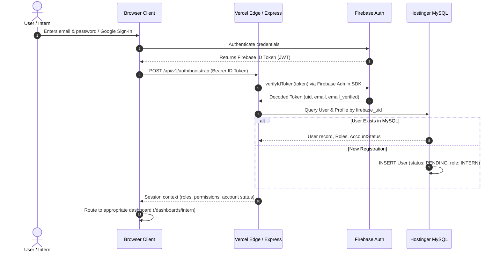

# IntelliCore V2.0 — Cloud Architecture Specification

## 1. Executive Architecture Summary

IntelliCore V2.0 is deployed as a **Cloud-Native Modular Monolith**. It preserves the unified, same-origin architecture where public pages, intern & staff dashboards, REST APIs, and background maintenance run within a single cohesive system without microservices, client-side SPA frameworks (such as React), or external state caches (such as Redis).

### Key Architectural Pillars:
- **Same-Origin Serving**: Web pages and `/api/v1/*` endpoints share the identical origin (`https://www.intellicoretechnologies.in`), completely eliminating cross-origin cookie issues and simplifying CORS/CSP policies.
- **Serverless Compute**: Express 5 on Vercel Node.js 24 LTS functions (`app.js`), scaling to zero on idle and handling traffic spikes automatically.
- **Relational Data Authority**: Hostinger MySQL 8.4 LTS / MariaDB 10.6+ is the single source of truth for accounts, roles, permissions, departments, attendance, tasks, learning progress, meetings, and audit trails.
- **Identity-Only Authentication**: Firebase Authentication is used strictly for identity verification (tokens and email lifecycle). All user accounts, statuses (`PENDING`, `ACTIVE`, `SUSPENDED`, `INACTIVE`), and RBAC roles live in MySQL.
- **Private Durable Storage**: Vercel Blob (`@vercel/blob`) with `access: 'private'`, streaming files through authenticated, permission-checked Express endpoints.
- **Bounded Background Processing**: Vercel Cron calling `/api/internal/notification-tick` with database-level atomic leasing (`NotificationCronState`), strictly bounded to 45 seconds per run.

---

## 2. Cloud Architecture Diagram

```mermaid
flowchart TD
    subgraph ClientBrowser ["Browser Client (Vanilla JS & HTML5)"]
        Landing["Public Landing Page (/)"]
        NotesUI["Notes AI (/pages/notes.html)"]
        Dashboards["Role Dashboards (/dashboards/*)"]
        AuthService["Client Auth Service (auth.js)"]
    end

    subgraph VercelEdge ["Vercel Edge Network (CDN)"]
        StaticAssets["Compiled Static Assets (/public)"]
        HeadersConfig["Security Headers & Caching"]
    end

    subgraph ServerlessCompute ["Vercel Serverless Functions (Node.js 24 LTS)"]
        ExpressApp["Express 5 Application (app.js)"]
        AuthMiddleware["Token Verifier (authenticate)"]
        RBACGuard["Role & Permission Guards (requireRole)"]
        BusinessModules["Business Services\n(Attendance, Tasks, Meetings, Follow-ups)"]
        CronHandler["Cron Worker Handler (/api/internal/notification-tick)"]
    end

    subgraph ExternalServices ["External Cloud Services"]
        FirebaseAuth["Firebase Authentication\n(intellicore-229 / intellicore-dev)"]
        HostingerDB["Hostinger Remote MySQL / MariaDB\n(Port 3306, TLS Encrypted)"]
        VercelBlob["Vercel Blob Storage\n(Private Attachments)"]
    end

    ClientBrowser -->|HTTP GET Static| VercelEdge
    ClientBrowser -->|HTTP POST/GET API| ExpressApp
    AuthService -->|ID Token Request| FirebaseAuth
    ExpressApp -->|Token Verification| FirebaseAuth
    ExpressApp -->|Prisma Client (TLS)| HostingerDB
    ExpressApp -->|Private File Stream| VercelBlob
    CronHandler -->|45s Bounded Tick| HostingerDB
```

---

## 3. End-to-End Request Flow & Identity Lifecycle



---

## 4. Subsystem Architectural Details

### 4.1. Edge CDN & Static Serving
- Static assets (`frontend/assets/`, `frontend/services/`, images, icons, and `pages/notes.html`) are compiled during the build step (`scripts/build-vercel-assets.js`) and emitted into `/public`.
- Vercel Edge automatically caches static assets with `Cache-Control: public, max-age=3600, s-maxage=86400` and `X-Content-Type-Options: nosniff`.
- Legacy URL compatibility aliases (such as `/functions/curriculum.js` and `/Photos/*`) are preserved directly on the Edge.

### 4.2. Database Connection Pooling for Serverless
Serverless environments can exhaust database connection pools if unmanaged. IntelliCore implements:
- **Connection Capping**: `connection_limit=2` per Vercel Function instance.
- **Timeouts**: `pool_timeout=5` seconds and `connect_timeout=5` seconds to prevent hanging functions.
- **Strict TLS**: `sslaccept=strict` enforced automatically on remote hosts. Insecure TLS bypass (`sslaccept=accept_invalid_certs`) is strictly blocked.
- **Singleton Persistence**: In serverless runtimes that retain execution contexts across invocations, `globalThis.prisma` reuses the active client instance.

### 4.3. Private Persistent Storage (Vercel Blob)
- Uploaded task attachments are stored with UUID-based keys in private cloud storage (`@vercel/blob`).
- Direct public URLs are never exposed to clients.
- File downloads are proxied through Express via `GET /api/v1/attachments/:id/download`, which enforces:
  1. Authenticated session.
  2. Active account state (`ACTIVE`).
  3. Ownership or authorized reviewer scope (`TEAM_LEADER`, `HR_MANAGER`, `FOUNDER`).
  4. Content streaming with `Content-Disposition: attachment; filename="..."` and `X-Content-Type-Options: nosniff`.
- Payload sizes are constrained to 4 MiB on Vercel to stay within serverless function limits.

### 4.4. Background Worker & Concurrency Control
- In cloud deployment, continuous polling loops (`while (true) sleep(...)`) are disabled.
- The background worker logic is triggered on a schedule via Vercel Cron.
- Concurrency and deduplication are protected via the `notification_cron_state` table:
  - Atomic leasing: `leaseToken = randomUUID()`, `leaseUntil = now + 90000ms`.
  - If another invocation is currently running, the job safely skips execution (`{ skipped: true }`).
  - Cursor tracking: Reminders and announcement queries resume from stored pagination cursors (`cursors.tasks`, `cursors.meetings`).
  - Execution boundary: The tick stops processing new jobs after 45 seconds (`+clock() - +now < 45000`), ensuring complete execution before Vercel's 60-second execution timeout.

---

## 5. Security & Boundary Invariants

1. **Mandatory Negative Certificate Boundary**:
   - Certificates are created and emailed manually outside IntelliCore.
   - Zero certificate PDF generation, zero certificate storage, zero certificate download routes, zero certificate QR verification endpoints, and zero automated certificate email outbox jobs.
   - Any probes to certificate generation/download routes return HTTP 404.
2. **Project Quarantine**:
   - Production Firebase (`intellicore-229`) is never accessed from local development or automated tests.
   - Local development uses `intellicore-dev`.
3. **No Silent Localhost Fallback**:
   - In production (`NODE_ENV=production` or `VERCEL=1`), the application will throw a fatal error on boot if remote database credentials are missing. It will never fall back to `localhost:3306`.
4. **Credential Redaction in Logs**:
   - Passwords and full connection URLs are sanitized using `sanitizeDatabaseUrl()`, replacing sensitive credentials with `****` in all logs and health diagnostics.
