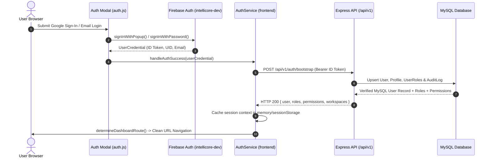

# IntelliCore V2.0 — Frontend Integration Specification

## 1. Architectural Foundation

IntelliCore V2.0 preserves the approved same-origin modular monolith architecture. Frontend pages and assets are served directly by Express 5 from `frontend/` without client-side frameworks (no React, no Vue, no Angular) or TypeScript compilation.

### Core Technologies
- **HTML5 & CSS3**: Native semantic markup with CSS custom properties (`frontend/assets/css/variables.css`).
- **Vanilla JavaScript**: Modern ES Modules (`type="module"`) utilizing browser-native Fetch API, DOM manipulation, and Web Storage.
- **Identity Provider**: Firebase Authentication Web SDK v10 (strictly confined to development project `intellicore-dev`).
- **Data & Business State**: 100% authoritative in MySQL 8.4 via REST API endpoints (`/api/v1/*`). Zero client-side Firestore or Cloud Functions.

---

## 2. Directory Layout & Entry Points

```
frontend/
├── assets/
│   ├── css/
│   │   ├── style.css             # Main public website styling
│   │   ├── variables.css         # Shared CSS variables, color tokens, typography
│   │   ├── dashboards.css        # Unified dashboard styles, layout, components
│   │   └── notes.css             # AI Notes Studio styling
│   ├── js/
│   │   ├── main.js               # Public website interactive logic
│   │   ├── auth.js               # Modal auth, login/signup form handling, tab switching
│   │   ├── dashboard-auth.js     # Shared dashboard authorization, logout, notices
│   │   ├── founder-dashboard.js  # Founder Command Center client logic
│   │   ├── hr-dashboard.js       # HR Operations Dashboard client logic
│   │   ├── tl-dashboard.js       # Team Leader Dashboard client logic
│   │   ├── intern-dashboard.js   # Intern Workspace client logic
│   │   ├── phase08-dashboard.js  # Phase 08 extensions, meetings launcher
│   │   ├── phase08-meetings.js   # Scoped meeting scheduling & join logic
│   │   └── phase08-followups.js  # Extensions, promotions, certificate dispatch
│   └── images/                   # Static branding, monograms, illustrations
├── pages/
│   ├── dashboards/
│   │   ├── founder/index.html    # Founder & Admin workspace shell
│   │   ├── hr/index.html         # HR & Operations workspace shell
│   │   ├── team-leader/index.html# Team Leader workspace shell
│   │   └── intern/index.html     # Intern self-service workspace shell
│   ├── 404.html                  # Branded error page for nonexistent routes
│   └── privacy-policy.html       # Public privacy policy
├── services/
│   ├── firebase.js               # Firebase Client SDK initialization (intellicore-dev)
│   └── auth.js                   # Client AuthService, token sync, routing logic
├── index.html                    # Public landing page
└── notes.html                    # AI Notes Studio
```

---

## 3. Client Authentication & Session Lifecycle

The client authentication flow bridges Firebase Authentication and MySQL relational state:



### 3.1 Token Synchronization & Request Signing
- All REST API calls pass the Firebase ID token in the standard `Authorization: Bearer <TOKEN>` header.
- Token refresh is automatically handled via `authService.getIdToken(true)` upon expiration.
- If the token is invalid or the session has expired, the user is redirected to `/?auth=login`.

### 3.2 Workspace Routing & Redirection Engine
When a user accesses any dashboard route:
1. `dashboard-auth.js` executes immediately upon script evaluation.
2. Checks Firebase authentication status via `authService.getCurrentUser()`.
3. If unauthenticated, records `redirectUrl` and sends browser to `/?auth=login`.
4. If authenticated, synchronizes with `/api/v1/auth/bootstrap` to retrieve active MySQL roles, status, and permissions.
5. Verifies that the user possesses at least one authorized role for that dashboard shell.
6. If unauthorized, routes the user to their appropriate canonical dashboard or shows an access-denied state.
7. Evaluates account status (`ACTIVE`, `PENDING`, `SUSPENDED`, `INACTIVE`) and renders appropriate alerts (`icWorkspaceNotice`).

---

## 4. UI/UX Consistency & Responsive Behavior

### Viewport Breakpoints
- **Mobile (`< 768px`)**: Single-column layout. Sidebar collapses off-canvas; toggled via topbar hamburger icon. Metrics stack in a 1-column grid. Tables convert to responsive cards or horizontal-scroll containers.
- **Tablet (`768px - 1024px`)**: Adaptive 2-column metrics grid. Collapsible navigation drawer.
- **Desktop (`> 1024px`)**: Persistent multi-column layout with fixed sidebar, topbar quick actions, 4-column metric card grid, and full-width data tables.

### Design Tokens (`frontend/assets/css/variables.css`)
- **Primary Color**: `#6C5CE7` (IntelliCore Purple)
- **Primary Dark**: `#5847EB`
- **Secondary / Accent**: `#00D2D3` (Cyan Accent)
- **Background Main**: `#0F0F1A` (Deep Slate)
- **Card Background**: `#1A1A2E`
- **Border Subtle**: `#2D2D4A`
- **Text Primary**: `#FFFFFF`
- **Text Secondary**: `#A0A0B8`
- **Success / Active**: `#00B894`
- **Warning / Pending**: `#FDCB6E`
- **Danger / Suspended**: `#FF7675`

---

## 5. Strict Negative Certificate Invariant in Frontend

In compliance with the project owner's mandate:
- **No Document Generation**: There are no buttons, forms, or triggers for generating certificate PDFs.
- **No File Downloads**: Zero download links (`.pdf`, `.png`, `.jpg`) for certificates exist anywhere in any dashboard or template.
- **No Public Verification Endpoints**: The public website and API contain no verification forms or QR code scanners.
- **Audited Declaration Only**: In HR Followups, the action is solely an audited radio selection or button to record that a human operator manually dispatched an external certificate (`SENT` or `NOT_SENT`). This declaration creates an in-app notice in the intern's notification feed.
