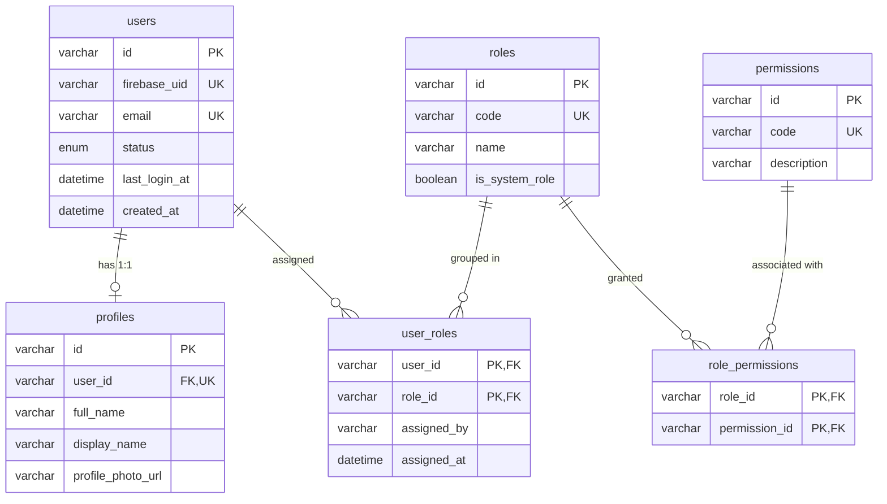

# IntelliCore Role-Based Access Control (RBAC) Specification

**Version:** 2.0.0  
**Phase:** MASTER-PHASE-02B  
**Environment:** Local Development  
**Date:** 2026-11-24  

---

## 1. Relational Schema & Hierarchy

RBAC is strictly maintained in MySQL using relational mapping tables managed by Prisma:



---

## 2. Seeded System Roles

All 8 system roles are seeded idempotently in `prisma/seed.js`:

| Role Code | Role Name | System Role | Primary Scope & Access |
| :--- | :--- | :---: | :--- |
| `FOUNDER` | Founder & Chief Executive | `true` | Full executive authority across all workspaces and domains |
| `CO_FOUNDER` | Co-Founder | `true` | Executive management and workspace oversight |
| `ADMIN` | System Administrator | `true` | User management, security controls, and technical infrastructure |
| `HR_MANAGER` | HR Manager | `true` | Human resources head; intern lifecycle and staff oversight |
| `HR_EXECUTIVE` | HR Executive | `true` | Onboarding, attendance audit, and intern document review |
| `OPERATIONS_EXECUTIVE` | Operations Executive | `true` | Cross-track task allocation, curriculum pacing, and scheduling |
| `TEAM_LEADER` | Team Leader | `true` | Technical domain mentor; task review and guidance |
| `INTERN` | Intern | `true` | Default role for self-registered learners; own-tasks and learning |

---

## 3. Seeded Permissions Matrix

| Permission Code | Description | FOUNDER | CO_FOUNDER | ADMIN | HR_MGR | HR_EXEC | OPS_EXEC | TL | INTERN |
| :--- | :--- | :---: | :---: | :---: | :---: | :---: | :---: | :---: | :---: |
| `auth:login` | Authenticate & maintain session | ✓ | ✓ | ✓ | ✓ | ✓ | ✓ | ✓ | ✓ |
| `profile:read_own` | View own user profile | ✓ | ✓ | ✓ | ✓ | ✓ | ✓ | ✓ | ✓ |
| `profile:update_own` | Update permitted profile fields | ✓ | ✓ | ✓ | ✓ | ✓ | ✓ | ✓ | ✓ |
| `workspace:founder` | Founder command center | ✓ | ✓ | — | — | — | — | — | — |
| `workspace:admin` | Technical administration | ✓ | — | ✓ | — | — | — | — | — |
| `workspace:hr` | Human resources workspace | ✓ | ✓ | — | ✓ | ✓ | — | — | — |
| `workspace:operations`| Operations workspace | ✓ | ✓ | — | — | — | ✓ | — | — |
| `workspace:team_leader`| Team Leader workspace | ✓ | ✓ | — | — | — | — | ✓ | — |
| `workspace:intern` | Intern dashboard shell | ✓ | ✓ | — | — | — | — | ✓ | ✓ |
| `users:read` | View user directory | ✓ | ✓ | ✓ | ✓ | — | — | — | — |
| `roles:read` | View role assignments | ✓ | ✓ | ✓ | — | — | — | — | — |

---

## 4. Founder Bootstrap Protocol

The `FOUNDER` role cannot be self-registered or assigned via public HTTP endpoints. It is initialized exclusively through an administrative CLI command:

```powershell
npm run founder:bootstrap
# Internally executes: node backend/src/scripts/bootstrapFounder.js
```

### Preconditions & Validations
1. Target project must match `intellicore-dev`.
2. `FOUNDER_FIREBASE_UID` and `FOUNDER_EMAIL` must be explicitly configured in `.env`.
3. Firebase Admin Auth retrieves and validates the genuine UID, verified email, and non-disabled state.
4. Database transaction verifies no conflicting primary founder exists.
5. User is created or updated with `status: ACTIVE` and assigned the `FOUNDER` role atomically.
