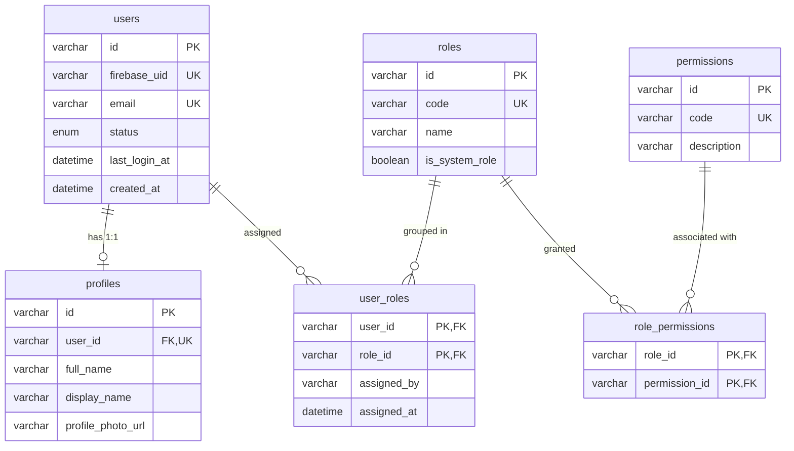

# IntelliCore Role-Based Access Control (RBAC) Specification

## Phase 07 notification and assessment permissions

All eight system roles receive `notifications:own`. Verified pending applicants receive their own onboarding notifications only. Announcement grants include `announcements:manage_all` for Founder and Co-Founder, `announcements:manage_interns` for HR Manager, `announcements:manage_operations` for Operations Executive and `announcements:manage_department` for Team Leader. Admin organization-authoring requires an explicit grant. HR Executive and Intern receive their own announcements.

The primary Founder receives `notifications:admin` and `notifications:operate`. ADMIN can receive read-only diagnostics with an explicit grant. Only the primary Founder can retry, cancel jobs or configure reminder windows. Founder, Co-Founder and Team Leader can use `tasks:amend_score` or `learning:correct_progress` in addition to their existing task-review or curriculum-management scope. Re-running the versioned seed preserves removals. [Announcement authorization](ANNOUNCEMENT_MANAGEMENT.md).

For current controls, see [Security rules](SECURITY_RULES.md) and the [API specifications](API.md). Earlier tables preserve the Phase 02B baseline.

## Phase 06 work and learning permissions

Each staff capability uses explicit `_all` or `_department` grants. The scope suffix authorizes the matching operational role and, for Team Leaders, current active department membership. For example, `tasks:review_department` permits technical review within assigned departments only. Owning an internship is required for own operations. The permission seed installs the defaults once and preserves later removal of new grants.

| Role | Default task access | Default learning access | Default performance access |
| --- | --- | --- | --- |
| FOUNDER | Organization read, manage and review | Organization read and manage | Organization metrics, scores and feedback |
| CO_FOUNDER | Organization read, manage and review | Organization read and manage | Organization metrics, scores and feedback |
| ADMIN | Organization status | Organization progress | Organization metrics |
| HR_MANAGER | Organization status | Organization progress | Organization metrics, scores and feedback |
| HR_EXECUTIVE | Organization status | Organization progress | Organization metrics |
| OPERATIONS_EXECUTIVE | Organization read and manage | Organization progress | Organization metrics |
| TEAM_LEADER | Assigned department read, manage and review | Assigned department read and manage | Assigned department metrics, scores and feedback |
| INTERN | `tasks:own` | `learning:own` | `performance:own` |

The six scoped capabilities are `tasks:read`, `tasks:manage`, `tasks:review`, `learning:read`, `learning:manage` and `performance:read`. Technical review governs access to private submitted work. `performance:feedback` adds evaluation history within report scope. Existing protected Founder administration remains guarded by the configured primary identity. [Security rules](SECURITY_RULES.md#phase-06-controls).

**Version:** 2.0.0  
**Phase:** MASTER-PHASE-02B  
**Environment:** Local Development  
**Date:** 2026-11-24  

---

## 1. Relational Schema & Hierarchy

RBAC is strictly maintained in MySQL using relational mapping tables managed by Prisma:



---

## 2. Seeded System Roles

All 8 system roles are seeded idempotently in `prisma/seed.js`:

| Role Code | Role Name | System Role | Primary Scope & Access |
| :--- | :--- | :---: | :--- |
| `FOUNDER` | Founder & Chief Executive | `true` | Full executive authority across all workspaces and domains |
| `CO_FOUNDER` | Co-Founder | `true` | Executive management and workspace oversight |
| `ADMIN` | System Administrator | `true` | User management, security controls, and technical infrastructure |
| `HR_MANAGER` | HR Manager | `true` | Human resources head; intern lifecycle and staff oversight |
| `HR_EXECUTIVE` | HR Executive | `true` | Onboarding, attendance audit, and intern document review |
| `OPERATIONS_EXECUTIVE` | Operations Executive | `true` | Cross-track task allocation, curriculum pacing, and scheduling |
| `TEAM_LEADER` | Team Leader | `true` | Technical domain mentor; task review and guidance |
| `INTERN` | Intern | `true` | Default role for self-registered learners; own-tasks and learning |

---

## 3. Seeded Permissions Matrix

| Permission Code | Description | FOUNDER | CO_FOUNDER | ADMIN | HR_MGR | HR_EXEC | OPS_EXEC | TL | INTERN |
| :--- | :--- | :---: | :---: | :---: | :---: | :---: | :---: | :---: | :---: |
| `auth:login` | Authenticate & maintain session | ✓ | ✓ | ✓ | ✓ | ✓ | ✓ | ✓ | ✓ |
| `profile:read_own` | View own user profile | ✓ | ✓ | ✓ | ✓ | ✓ | ✓ | ✓ | ✓ |
| `profile:update_own` | Update permitted profile fields | ✓ | ✓ | ✓ | ✓ | ✓ | ✓ | ✓ | ✓ |
| `workspace:founder` | Founder command center | ✓ | ✓ | — | — | — | — | — | — |
| `workspace:admin` | Technical administration | ✓ | — | ✓ | — | — | — | — | — |
| `workspace:hr` | Human resources workspace | ✓ | ✓ | — | ✓ | ✓ | — | — | — |
| `workspace:operations`| Operations workspace | ✓ | ✓ | — | — | — | ✓ | — | — |
| `workspace:team_leader`| Team Leader workspace | ✓ | ✓ | — | — | — | — | ✓ | — |
| `workspace:intern` | Intern dashboard shell | ✓ | ✓ | — | — | — | — | ✓ | ✓ |
| `users:read` | View user directory | ✓ | ✓ | ✓ | ✓ | — | — | — | — |
| `roles:read` | View role assignments | ✓ | ✓ | ✓ | — | — | — | — | — |

---

## 4. Founder Bootstrap Protocol

The `FOUNDER` role cannot be self-registered or assigned via public HTTP endpoints. It is initialized exclusively through an administrative CLI command:

```powershell
npm run founder:bootstrap
# Internally executes: node backend/src/scripts/bootstrapFounder.js
```

### Preconditions & Validations
1. Target project must match `intellicore-dev`.
2. `FOUNDER_FIREBASE_UID` and `FOUNDER_EMAIL` must be explicitly configured in `.env`.
3. Firebase Admin Auth retrieves and validates the genuine UID, verified email, and non-disabled state.
4. Database transaction verifies no conflicting primary founder exists.
5. User is created or updated with `status: ACTIVE` and assigned the `FOUNDER` role atomically.
6. Inappropriate default `INTERN` role assignment is purged atomically.
7. Verification status: **INITIALIZED & VERIFIED ACTIVE** for `ctrlabhishek@gmail.com` (UID `svNt0UTSz9N59EzlaTWR7jsCu5c2`).

## Phase 08 meetings and follow-up

| Role | Meetings | Internship follow-up |
| --- | --- | --- |
| Primary Founder | Organization scope | Declarations, extensions, designation decisions, staff recommendation decisions and protected provisioning |
| Co-Founder and Admin | Organization scope with `meetings:manage_all` | Existing internship rights and own records |
| HR Manager | Own internship or HR department meetings with `meetings:manage_hr` | Declarations, extensions, intern designations and staff recommendations |
| HR Executive | Own invitations | Scoped read only |
| Operations Executive | Own staff and department meetings with `meetings:manage_operations` | Existing internship rights and own records |
| Team Leader | Assigned active departments with `meetings:manage_department` | Scoped extension and promotion history |
| Intern | Own invitations, response and authorized link | Own periods, promotion history and dispatch status |

Calendar additionally requires the configured organizer identity. Staff activation relies on the existing primary-Founder permissions and a recent sign-in. [Security rules](SECURITY_RULES.md).
